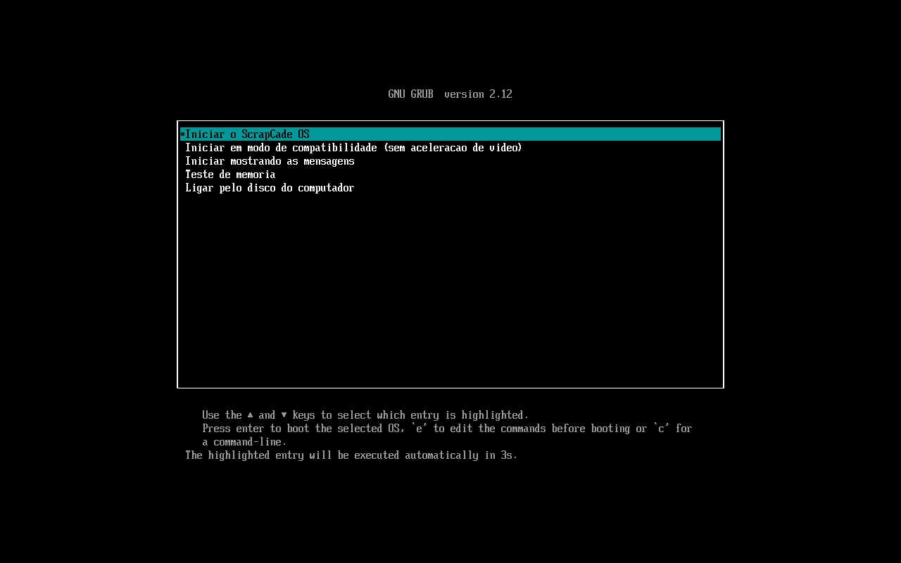
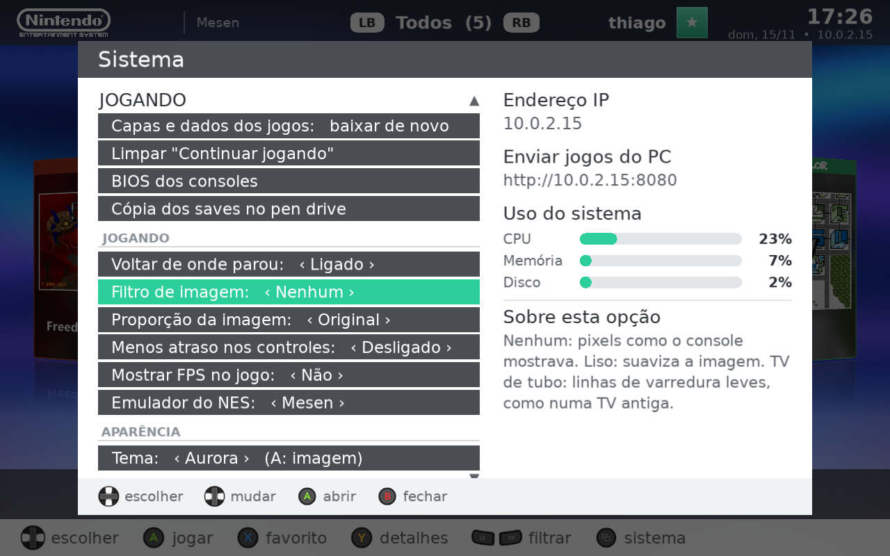
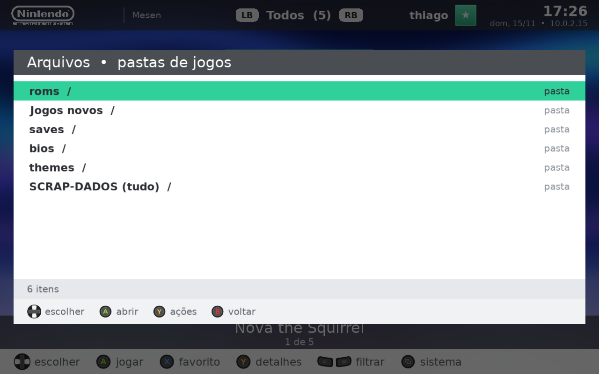
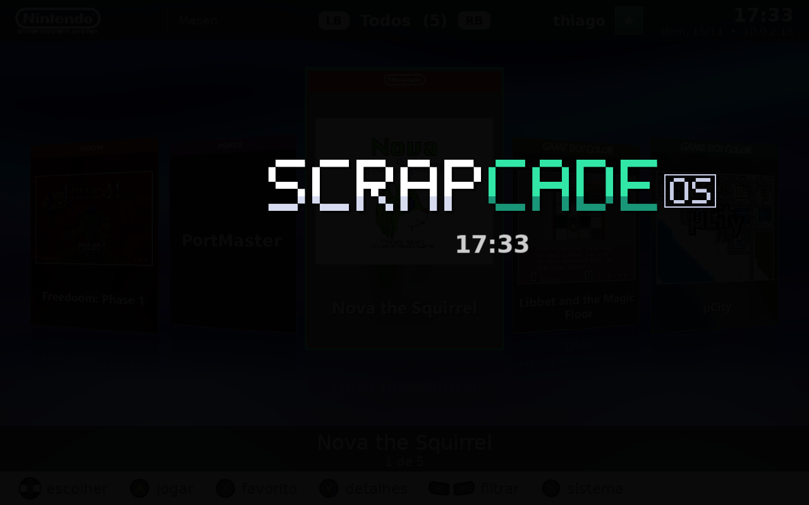

# ScrapCade OS

<p align="center"></p>

<p align="center">
  
  
  
  
</p>

**Sistema operacional para emulação de jogos que dá uma segunda vida a computadores que iriam para o lixo.** É um Linux próprio (kernel 6.12, montado com o Buildroot 2026.02) que liga direto num menu de jogos, o **ScrapCade**, feito em C++ e SDL2. Roda em PCs e notebooks de 64 bits, por BIOS antigo ou UEFI, a partir de um pen drive ou instalado no HD. Uma versão para PCs de 32 bits está a caminho.

<p align="center"><a href="https://github.com/thiagotechmaker/scrapcade.os/releases/latest"><b>⬇️ Baixar a versão mais nova (.iso, PC 64 bits)</b></a></p>

## Sobre e capturas

**Instalar:**

1. Baixe o `.iso` em [Releases](https://github.com/thiagotechmaker/scrapcade.os/releases/latest). É um arquivo só, que liga por BIOS antigo e por UEFI.
2. Grave num pen drive de 4 GB ou mais com o [Rufus](https://rufus.ie) (modo ISO ou DD) ou o [balenaEtcher](https://etcher.balena.io).
3. Ligue o PC pelo pen drive (tecla do menu de boot: F12, F9, F8 ou Esc). No primeiro boot ele arruma o pen drive sozinho (sistema + partição SCRAP-DADOS para os jogos) e abre a criação do seu perfil.
4. Coloque jogos pelo navegador do PC ou do celular (o endereço aparece na tela), pela pasta na rede do Windows ou por um pen drive. Cada jogo vai sozinho para o console certo, com capa e dados.
5. Para ligar sem o pen drive: *Sistema > Instalar no disco do computador*.

As versões novas chegam sozinhas pelo próprio sistema, sem mexer em jogos e saves. Jogos, BIOS e ROMs não acompanham o sistema.

**Boot:** menu próprio (GRUB e syslinux), com modo de compatibilidade e teste de memória, e a logo do ScrapCade OS desenhada pelo initrd.

<p align="center"> </p>

**Menu de jogos:** carrossel de capas com filtros por console (LB/RB), "Continuar jogando", favoritos e os dados de cada jogo. Nas capturas aparecem jogos de fãs com licença livre ([µCity](https://github.com/AntonioND/ucity), [Nova the Squirrel](https://github.com/NovaSquirrel/NovaTheSquirrel), [Libbet](https://github.com/pinobatch/libbet), [Freedoom](https://freedoom.github.io)), que o próprio sistema baixa em *Sistema > Jogos grátis*.


**Painel Sistema** (botão Select ou tecla Tab), em seções como o menu de ajustes de um console: Jogos, Jogando, Aparência, Controle e som, Tela e energia, Rede e Sistema. Do lado direito ele explica cada opção.

<p align="center"> </p>

<p align="center"> </p>

<p align="center"> </p>

<details><summary>Ver tudo o que o sistema faz</summary>

- **Perfis** com avatar ("Quem vai jogar?"), cada um com favoritos, saves e preferências.
- **Consoles:** NES, Super Nintendo, Mega Drive, Master System, Game Gear, Game Boy, Game Boy Color, Game Boy Advance, PlayStation, Nintendo 64, PSP, Nintendo DS, Sega Saturn, Dreamcast, Fliperama e Neo Geo (FBNeo), pelo RetroArch. Também Doom e jogos `.wad` (PrBoom), **Half-Life** (Xash3D: copie a pasta `valve` da sua cópia da Steam para `roms/halflife`) e os ports do PortMaster.
- **Jogando:** voltar de onde parou, filtro de imagem (liso ou TV de tubo), proporção, menos atraso nos controles (run-ahead), FPS na tela, emulador de cada console. Em todo jogo, Select + Start sai e Select + X abre o menu do emulador.
- **Jogos:** jogos grátis de licença livre, trazer do pen drive, gerenciador de arquivos (copiar, mover, clonar, renomear, apagar para a Lixeira), ordenar, consoles vazios, BIOS dos consoles, cópia dos saves no pen drive. Se um jogo não abrir, o sistema avisa na tela.
- **Aparência:** 8 temas ou uma imagem sua, tamanho do texto, animações, proteção de tela.
- **Tela e energia:** perfis de energia, desligar sozinho, relógio 12/24 h.
- **Rede:** Wi-Fi, Bluetooth (controles sem fio), pasta na rede do Windows (Samba), SSH, envio de jogos pelo navegador.
- **Sistema:** atualização A/B pela internet (se a versão nova não ligar, volta sozinha para a anterior), instalar no HD, modo desktop (Fluxbox), voltar tudo ao padrão.

</details>

O mesmo menu roda num analisador de laboratório reaproveitado como fliperama: [ScrapCade no iChroma](https://github.com/thiagotechmaker/scrapcade-fliperama).

## Hardware suportado

| Máquina | Boot | Vídeo | Som | Rede | Controles | Situação |
|---|---|---|---|---|---|---|
| QEMU x86_64 (UEFI/OVMF e BIOS) | ✅ | ✅ virtio/std | ✅ Intel HDA | ✅ e1000 | ✅ teclado e controle | testado a cada versão (bateria automática) |
| Dell Inspiron N5010 (Core i3/i5 1ª geração, Intel HD, BIOS) | ⏳ | ⏳ | ⏳ | ⏳ Wi-Fi | ⏳ | aguardando teste no aparelho |
| PCs de 32 bits (Pentium 4, Pentium M, Atom) | — | — | — | — | — | versão i686 em desenvolvimento |

<details><summary>Ver os drivers incluídos</summary>

- **Vídeo:** Intel (i915, crocus, iris), AMD (amdgpu, radeon, radeonsi, r300, r600), NVIDIA (nouveau), Vulkan (Intel ANV e lavapipe), e desenho pela CPU (llvmpipe) quando a placa não ajuda.
- **Som:** Intel HDA e placas USB, com PipeWire.
- **Rede com cabo:** Intel e1000/e1000e/igb, Realtek r8169, Atheros atl1/atl1c/atl1e/alx.
- **Wi-Fi:** Intel (iwlwifi, 3945 e 4965), Atheros (ath9k, ath10k, carl9170), Ralink/MediaTek (rt2800, rt73), Realtek (rtl8xxxu e as linhas 81xx/87xx/88xx), com os firmwares redistribuíveis.
- **Controles:** Xbox (xpad), PlayStation 3/4/5, Nintendo (Switch), Steam e genéricos pelo banco de controles do SDL2; Bluetooth; assistente para ensinar os botões de um controle desconhecido.

</details>

**Limitações conhecidas:** PS2, GameCube, Wii, 3DS e PC (DOS) aparecem no menu mas ainda não têm emulador; os ports do PortMaster são feitos para portáteis ARM, então poucos rodam em PC; sem Secure Boot.

## Estrutura de pastas

```
.
├── build-x86_64.sh            compila a imagem de 64 bits (output/x86_64)
├── build-i686.sh              compila a imagem de 32 bits (output/i686)
├── external/                  árvore externa do Buildroot (BR2_EXTERNAL)
│   ├── configs/               tos_x86_64_defconfig, tos_i686_defconfig
│   ├── board/x86_64/          boot (GRUB, syslinux, initramfs), kernel (linux.config e fragmentos), scripts de imagem e .iso
│   ├── board/common/          rootfs-overlay: comandos tos-* (instalar, atualizar, jogar, rede), configuração do RetroArch
│   └── package/               scrapcade (o menu, em C++/SDL2), retroarch, núcleos libretro, xash3d-fwgs, hlsdk-portable
├── tests/                     bateria automática no QEMU (testar.sh) e telas de referência
├── scripts/                   publicar-versao.ps1 (sobe a versão aprovada nas Releases)
└── docs/                      detalhes técnicos, composição, roteiro e capturas
```

O Buildroot fica em `buildroot/` e as compilações em `output/`, os dois fora do Git (`.gitignore`). As imagens prontas (`.iso`) vão só nas [Releases](https://github.com/thiagotechmaker/scrapcade.os/releases).

## Como compilar

Num Ubuntu 24.04 (ou WSL2), com uns 40 GB livres:

```bash
sudo apt install build-essential gcc-multilib git wget unzip rsync bc cpio file libncurses-dev python3 \
                 qemu-system-x86 ovmf mtools dosfstools python3-pil
git clone https://github.com/thiagotechmaker/scrapcade.os.git ~/scrapcade.os
git clone --depth 1 --branch 2026.02.3 https://gitlab.com/buildroot.org/buildroot.git ~/scrapcade.os/buildroot
bash ~/scrapcade.os/build-x86_64.sh          # make tos_x86_64_defconfig + make; resultado em output/x86_64/images
bash ~/scrapcade.os/tests/testar.sh          # opcional: bateria automática no QEMU (precisa do qemu, ovmf, mtools e python3-pil)
```

A primeira compilação baixa e compila tudo (algumas horas); as seguintes só o que mudou. Para 32 bits: `bash ~/scrapcade.os/build-i686.sh`. Detalhes em [docs/DETALHES.md](docs/DETALHES.md), [docs/COMPOSICAO.md](docs/COMPOSICAO.md) e [docs/ROTEIRO.md](docs/ROTEIRO.md); o histórico de versões está no [CHANGELOG.md](CHANGELOG.md).

## Licença

Código do ScrapCade OS e do menu ScrapCade: **GPLv3** (ver [LICENSE](LICENSE)). Os arquivos em `external/board/x86_64/` vêm da configuração de PC do Buildroot (GPL-2.0 ou posterior). O kernel Linux é GPL-2.0, e cada programa incluído na imagem mantém a licença dos seus autores (lista em [docs/COMPOSICAO.md](docs/COMPOSICAO.md)). O Half-Life usa o hlsdk-portable, sob a licença do Half-Life 1 SDK (distribuição só gratuita); os dados do jogo não acompanham o sistema. Logotipos de consoles e marcas são dos seus titulares e aparecem só para identificação.
