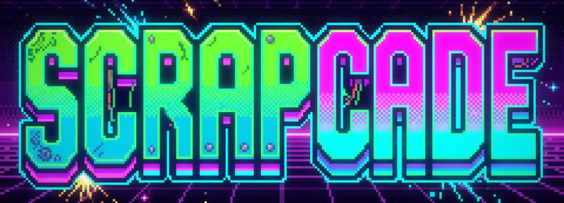
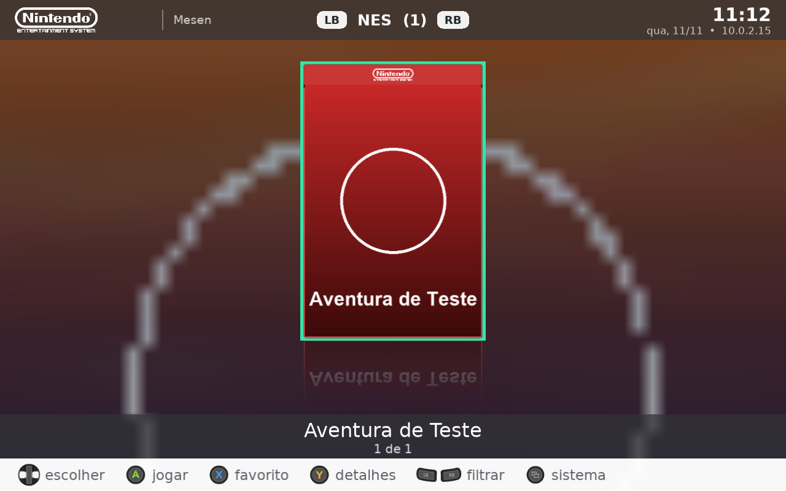
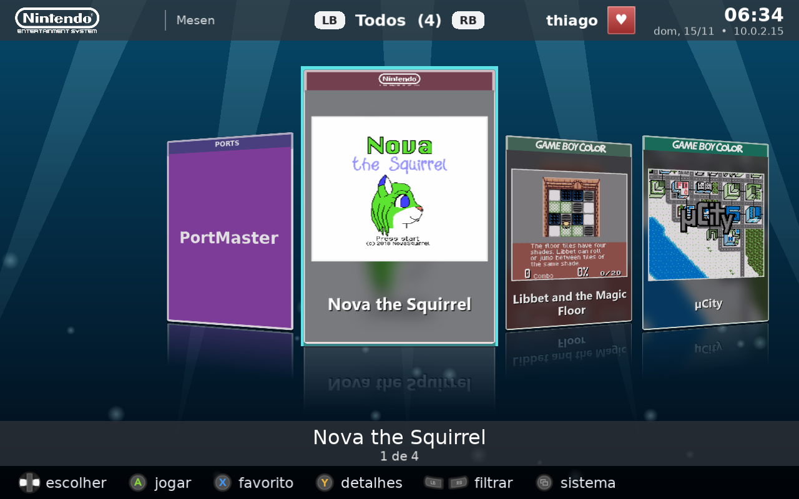
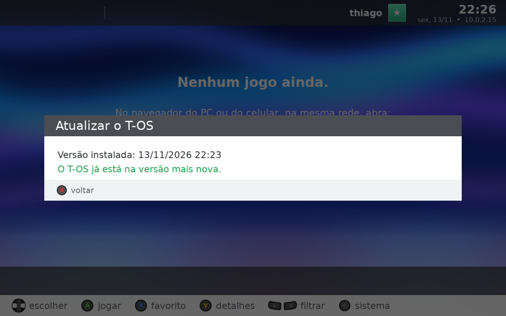

# ScrapCade

<p align="center"></p>

<p align="center"><b>Jogos em qualquer computador.</b><br>
Sistema próprio, baseado em Linux, para <b>emulação de jogos</b> e para dar uma <b>segunda vida a computadores que iriam para o lixo</b>.</p>

<p align="center"><a href="https://github.com/thiagotechmaker/scrapcade/releases/latest"><b>⬇️ Baixar a versão mais nova (.iso, PC 64 bits)</b></a></p>

## Baixar e instalar

1. **Baixe** o `scrapcade-<versão>-pc-64bits.iso` em [Releases](https://github.com/thiagotechmaker/scrapcade/releases/latest). É um arquivo só, que liga por BIOS antigo e por UEFI.
2. **Grave** num pen drive de 4 GB ou mais com o [Rufus](https://rufus.ie) (modo ISO ou DD, tanto faz) ou o [balenaEtcher](https://etcher.balena.io).
3. **Ligue o PC pelo pen drive** (tecla do menu de boot: F12, F9, F8 ou Esc). No primeiro boot o ScrapCade arruma o pen drive sozinho (sistema + partição TOS-DADOS para os jogos), pede a senha do administrador e abre a criação do seu perfil.
4. **Coloque jogos** pelo navegador do PC ou celular (o endereço aparece na tela), pela pasta na rede do Windows ou por um pen drive (*Sistema > Trazer jogos do pen drive*).
5. **Quer ligar sem o pen drive?** O ScrapCade pergunta uma vez se quer instalar no HD/SSD (também em *Sistema > Instalar no disco do computador*).

As versões novas chegam sozinhas: o ScrapCade avisa na tela e atualiza em *Sistema > Atualizar o ScrapCade*, sem mexer nos jogos e saves. Jogos, BIOS e ROMs não acompanham o sistema.

O ScrapCade é montado com o [Buildroot](https://buildroot.org), a mesma ferramenta usada pelo Batocera: compila do código-fonte só o que o sistema precisa.

## Capturas

**1. GRUB iniciando o ScrapCade** (espera de 1 segundo):


**2. Boot do Linux** até a tela de login:


**3. Sistema ligado:** identificação, versão do kernel, memória e disco em uso:


Depois de ligar, o ScrapCade usa **26 MB de RAM** e **62 MB de disco**.

## Modo jogo

Como numa Steam Machine, o ScrapCade liga direto no **modo jogo**: o menu abre em tela cheia. O login de manutenção fica no segundo terminal (**Ctrl+Alt+F2**). O **modo desktop** (Fluxbox, gerenciador de arquivos, navegador) é uma opção à parte, no painel Sistema.

O menu do ScrapCade é a conversão do ScrapCade do iChroma (Android) para **C++ com SDL2**, com as mesmas medidas, cores e funções.

**Carrossel de capas** com perspectiva, reflexo, faixa e logo do console, borda na selecionada e fundo do jogo borrado:


**Filtros com LB/RB** (Todos, Favoritos, Mais jogados e cada console):



**Temas** (Aurora, Carbono, Neon, Arcade, Claro, 8 bits, Portátil e Oceano, todos desenhados pelo próprio ScrapCade), aqui no Oceano:



**Temas seus:** cada pasta em `TOS-DADOS/themes/` vira um tema a mais em *Sistema > Tema* (dá para mandar pela página de Arquivos, pasta **Temas**):

```
themes/
  Meu tema/
    fundo.png        imagem de fundo (ou fundo.jpg), preenche a tela
    tema.txt         nome=Meu tema
                     base=Neon        (cartões e cores de um tema pronto)
                     destaque=#FF7A00 (cor da borda e dos detalhes)
    avatares/        imagens para escolher ao criar um perfil
  avatares/          avatares que valem para qualquer tema
```

As imagens ficam só no aparelho de quem colocou: o ScrapCade não traz nenhuma imagem de marca.

**Perfis de jogador**, no estilo dos painéis de console: cada perfil tem avatar, favoritos, preferências e saves próprios, com senha opcional. Ao ligar, o ScrapCade pergunta "Quem vai jogar?":


**Painel Sistema** (botão Select ou Tab): perfil, energia, tema, volume, Wi-Fi, Bluetooth, pasta na rede do Windows, SSH, configurar controle, modo desktop, BIOS, atualizar o ScrapCade, instalar no HD:


**Atualizar o ScrapCade** pelo próprio painel: baixa a versão nova das [Releases](https://github.com/thiagotechmaker/scrapcade/releases), confere o SHA-256 e guarda a versão de agora. Se a nova não ligar 3 vezes, volta sozinho para a anterior (também dá para escolher "Sistema anterior do ScrapCade" no menu de boot). Jogos e saves não são mexidos.



As capas das capturas são de teste, feitas para o projeto. O menu desenha pela GPU (OpenGL ES pela Mesa) e lê teclado e controle pelo SDL2. Código em `external/package/scrapcade/src`.

**Capas, dados e organização automática (ScrapCade 0.3):**

- **Pasta "Jogos novos"** (`/userdata/Jogos novos`): o jogo copiado ali vai sozinho para o console certo. Vale ROM solta, `.zip` com a ROM dentro, CD (`.cue` + `.bin`), Neo Geo (a BIOS que vier junto vira `neogeo.zip`), arcade do FBNeo e imagens de disco (`.iso`, `.rvz`: GameCube, Wii, PSP, PS1 ou PS2 pelo cabeçalho do disco). Arquivo ainda sendo copiado espera 10 s sem mudar de tamanho. O que não for reconhecido vai para `nao_reconhecidos`.
- **Dados do jogo pelo CRC**, sem rede: nome oficial, ano, empresa e gênero, mostrados embaixo da capa e no painel de detalhes (botão **Y**).
- **Capa e fundo baixados sozinhos** do acervo [libretro-thumbnails](https://thumbnails.libretro.com), sem conta. O que o acervo não tem fica anotado para não tentar de novo; sem rede, tenta outra vez a cada minuto.
- Registro do ScrapCade em `/userdata/system/logs/scrapcade.log`.

## Emuladores

O ScrapCade empacota o **RetroArch 1.22.2** (direto na placa de vídeo pelo KMS, sem X, menu RGUI em português) e estes núcleos libretro:

| Console | Núcleo |
|---|---|
| NES | Mesen |
| Super Nintendo | Snes9x (ou bsnes, trocando no painel de detalhes com X) |
| Mega Drive, Master System, Game Gear | Genesis Plus GX |
| Game Boy, Game Boy Color | Gambatte |
| Game Boy Advance | mGBA |
| PlayStation | PCSX ReARMed (tem BIOS livre embutida) |
| Nintendo 64 | Mupen64Plus-Next |
| Fliperama e Neo Geo | FBNeo (Neo Geo precisa do `neogeo.zip` do usuário) |
| PSP | PPSSPP |
| Nintendo DS | melonDS (precisa das BIOS do DS do usuário) |
| Sega Saturn | Beetle Saturn (precisa da BIOS do usuário) |
| Dreamcast | Flycast (BIOS do usuário recomendada) |

- **Configuração central:** o `tos-jogar` passa a mesma configuração para todo emulador (vídeo, som, controles, atalhos e pastas). Para mudar algo só seu: `TOS-DADOS/system/configs/retroarch/retroarch-usuario.cfg`.
- **Atalhos iguais em todo jogo:** **Select + Start** sai, **Select + X** abre o menu, **Select + RB/LB** salva/carrega. No teclado: **Esc** sai, **F1** abre o menu. O ScrapCade mostra esses atalhos ao abrir cada jogo.
- **Nunca perder o progresso:** o jogo salva sozinho ao sair e continua de onde parou.
- **Controles:** reconhecidos pelo banco de dados do SDL2 (Xbox, PlayStation, Nintendo, genéricos), sem configurar.
- **Pastas na TOS-DADOS:** `saves/<console>`, `bios`, `screenshots`. O gerenciador da página mostra também `bios`, `saves` e `Registros` (logs, para pedir ajuda).

## Como o ScrapCade fica no disco

Parecido com o Batocera, mas pensado para não perder jogos:

| Partição | Formato | O que tem |
|---|---|---|
| **TOS-BOOT** | FAT32, 1 GB (tabela MBR, GRUB para UEFI e para BIOS) | GRUB, kernel, um initrd pequeno e o sistema inteiro em `boot/tos.squashfs` (somente leitura) |
| **TOS-DADOS** | exFAT, o resto do disco | `roms`, `bios`, `saves`, `themes`, `Jogos novos` e as configurações (`system`: senha, rede, ScrapCade) |

- **Sistema somente leitura:** o initrd monta o `tos.squashfs` com uma camada na memória por cima. Desligar da tomada não estraga o sistema.
- **A TOS-DADOS é criada no primeiro boot**, no espaço livre do pen drive ou do HD. Nada é redimensionado: a partição nova ocupa o espaço vazio.
- **Atualizar o ScrapCade** pelo painel Sistema (atualização A/B com volta automática) ou trocando o `tos.squashfs` à mão (dá até pelo Windows, a TOS-BOOT é FAT32). A TOS-DADOS nunca é mexida.
- **exFAT** para o Windows ler e gravar os jogos direto.

## Arquivos de cada versão

Cada versão fica em [Releases](https://github.com/thiagotechmaker/scrapcade/releases), já com a atualização automática dentro:

| Arquivo | Para quê |
|---|---|
| `t-os-<versão>-pc-64bits.iso` | **o ScrapCade inteiro, um arquivo só**, para PC de 64 bits (BIOS antigo e UEFI) |
| `tos.squashfs`, `bzImage`, `initrd.gz` | usados pela atualização automática |
| `SHA256SUMS` | confere todos os arquivos |

Quem já tem o ScrapCade não precisa baixar nada: uns 40 s depois de ligar ele procura a versão nova e avisa na tela; a troca é em *Sistema > Atualizar o ScrapCade*. Para publicar uma versão compilada: `powershell -File scripts\publicar-versao.ps1`.

## Gravar e ligar

Um arquivo só: o `.iso`. Grave num pen drive de **4 GB ou mais** com o [Rufus](https://rufus.ie) (modo ISO ou modo DD, tanto faz) ou o [balenaEtcher](https://etcher.balena.io).

No **primeiro boot** o ScrapCade se copia para a memória e arruma o pen drive sozinho, do mesmo jeito qualquer que tenha sido a gravação:

| Partição | O que fica |
|---|---|
| **TOS-BOOT** (FAT32, 1 GB) | o sistema, somente leitura (atualização automática A/B) |
| **TOS-DADOS** (exFAT, o resto) | jogos, BIOS, saves, temas e perfis, sem limite de 4 GB por arquivo |

Daí em diante o ScrapCade **roda direto do pen drive**, como o Batocera. Para ligar sem o pen drive, quando quiser: *Sistema > Instalar no disco do computador* (copia o ScrapCade, e se quiser os jogos, para o HD ou SSD).

- Gravado em **DVD**, ou com `tos.vivo` acrescentado aos parâmetros no menu de boot (tecla Tab no BIOS, `e` no UEFI), o ScrapCade só roda, sem mexer em nada (os jogos ficam na memória até desligar).
- Precisa de 1,5 GB de memória para arrumar o pen drive; com menos, roda sem arrumar.

No notebook, ligue pelo pen drive (tecla do menu de boot: F12, F9, F8 ou Esc, conforme a marca). **Liga tanto por UEFI quanto por BIOS antigo (Legacy/CSM)**; se o notebook usar UEFI e recusar o pen drive, desligue o Secure Boot. No primeiro boot o ScrapCade pede a senha do administrador.

O kernel traz os controladores USB 1.1/2.0/3.0, SATA, NVMe e leitor de cartão SD, para achar o pen drive e o HD também em máquinas antigas. As placas de vídeo (Intel, AMD, NVIDIA pelo Nouveau) são módulos: só a da máquina é carregada.

**Painel Sistema** (botão **Select** ou tecla **Tab**): tema, animações, capas, fundo do jogo, **motor gráfico**, **modo desktop**, como jogar, informações do sistema, reiniciar e desligar, com IP, endereço da página e uso de CPU, memória e disco.

**Modo desktop** (Sistema > Modo desktop): Fluxbox com um pacote leve de programas: **navegador** (NetSurf), **arquivos** (PCManFM), **terminal**, **editor de texto** (nano), **vídeos e músicas** (mpv), **imagens** (feh), **PDF** (MuPDF) e **volume do som**. O menu abre com o botão direito ou **Alt + F1**. **O que o navegador baixa vai para "Jogos novos"** e entra sozinho no console certo (o ScrapCade não traz endereço de jogos). "Voltar ao modo jogo" reabre o ScrapCade. LibreOffice não existe no Buildroot.

## Pen drive com jogos

Ligue um pen drive com jogos (FAT32, exFAT, NTFS ou ext4) com o ScrapCade aberto: ele é lido **somente leitura**, os jogos que ainda não vieram são copiados para "Jogos novos" e vão sozinhos para o console certo. No fim aparece "Pode tirar". O ScrapCade lembra o que já copiou de cada pen drive.

## Instalar no computador

**Sistema > Instalar no disco do computador**: escolha o disco (HD, SSD ou NVMe; o pen drive do ScrapCade não aparece na lista), confirme (o disco é **apagado**) e escolha se leva os jogos, saves, BIOS e configurações. O instalador cria TOS-BOOT e TOS-DADOS no disco e registra o ScrapCade no menu de boot da placa-mãe. Depois é só desligar, tirar o pen drive e ligar.

## O que cada parte faz

| Parte | O que faz |
|---|---|
| **GRUB 2 (UEFI)** | Primeiro programa que roda quando o PC liga. Encontra o kernel na partição de boot e o inicia. |
| **Kernel Linux 6.12.47 (LTS)** | Coração do sistema: conversa com o processador, a memória, os discos, a placa de rede e o vídeo. A versão LTS recebe correções por anos. |
| **Compilador Bootlin (glibc)** | Conjunto de compiladores pronto, usado para compilar o sistema todo. Economiza cerca de 30 minutos por compilação. |
| **BusyBox** | Reúne em um só programa pequeno o `init` (primeiro processo, que inicia os outros), o terminal e os comandos básicos (`ls`, `cp`, `mount`...). |
| **eudev** | Detecta o hardware ligado (pen drive, controle, placa de rede) e cria os arquivos de dispositivo em `/dev`. |
| **D-Bus** | Canal de comunicação entre os serviços do sistema. |
| **ConnMan** | Gerencia a rede: cabo e Wi-Fi. |
| **linux-firmware** | Firmwares das placas de Wi-Fi e rede (Intel, Realtek, Atheros, Ralink). Sem eles, essas placas não funcionam. |
| **syslogd / klogd** | Guardam os registros do sistema e do kernel, para descobrir problemas. |
| **acpid** | Trata o botão de ligar e eventos de energia (desligar ao apertar o botão). |
| **crond** | Executa tarefas agendadas. |
| **Primeiro boot** | Script `S01primeiro-boot`: se o administrador ainda não tem senha, pede para criar uma antes do login. |
| **ScrapCade** | Menu de jogos (modo jogo), em C++ com SDL2. Abre no boot pelo serviço `S99scrapcade`. |
| **Mesa + LLVM** | Drivers de vídeo abertos (Intel, AMD, NVIDIA/Nouveau) e o `llvmpipe` para PC sem placa de vídeo. |
| **SDL2** | Base do ScrapCade: tela pela GPU (KMS/DRM, sem servidor gráfico), controles, imagens PNG/JPEG e fontes. |
| **DejaVu Sans** | Fonte usada no menu (só as variantes Sans, para economizar espaço). |
| **genimage** | Monta o `disk.img` final: tabela GPT, partição EFI (com o GRUB e o kernel) e partição do sistema (ext4, 512 MB). |

## Como foi feito

1. **Ambiente:** Ubuntu 24.04 no WSL2 (Windows), com as ferramentas que o Buildroot exige (`build-essential`, `git`, `rsync`, `bc`, `cpio`, `unzip`, `wget`, `file`, `python3`, `libncurses-dev`...).
2. **Buildroot 2026.02.3 (LTS)**, baixado do repositório oficial.
3. **Árvore externa própria** (`external/`): tudo que é do ScrapCade fica separado do Buildroot. Assim dá para atualizar o Buildroot sem perder as mudanças.
4. **Configuração `tos_x86_64_defconfig`**, partindo da configuração de PC com UEFI do Buildroot, com:
   - nome, versão e hostname do ScrapCade (`/etc/os-release`, `/etc/issue`);
   - compilador estável da Bootlin;
   - partição do sistema de 512 MB;
   - menu do GRUB com o nome ScrapCade e espera de 1 segundo;
   - boot silencioso (`quiet`), sem os textos do kernel na tela;
   - pedido de senha do administrador no primeiro boot.
5. **Compilação:** cerca de 27 minutos na primeira vez (Ryzen 7, 16 threads), poucos minutos nas seguintes.
6. **Teste:** máquina virtual QEMU com firmware UEFI (OVMF).

## Estrutura do repositório

```
external/
  external.desc              nome da árvore externa (TOS)
  Config.in, external.mk     pacotes próprios do ScrapCade
  package/scrapcade/         menu de jogos (código em C, serviço de início)
  configs/
    tos_x86_64_defconfig     configuração da imagem para PC 64 bits
  board/
    x86_64/                  GRUB, kernel, scripts de imagem do PC (base do Buildroot)
    common/rootfs-overlay/   arquivos que entram em todas as imagens (identidade do ScrapCade)
build-x86_64.sh              compila a imagem x64
docs/capturas/               prints do sistema
```

## Como compilar

No Ubuntu (ou WSL2 com Ubuntu):

```bash
sudo apt install -y build-essential git rsync bc cpio unzip wget file python3 libncurses-dev perl patch gzip bzip2 tar
git clone https://github.com/thiagotechmaker/scrapcade.git ~/t-os
git clone --depth 1 --branch 2026.02.3 https://gitlab.com/buildroot.org/buildroot.git ~/t-os/buildroot
bash ~/t-os/build-x86_64.sh
```

A imagem fica em `~/t-os/output/x86_64/images/disk.img`.

## Como testar sem gravar pen drive

```bash
sudo apt install -y qemu-system-x86 ovmf
qemu-system-x86_64 -m 2048 -bios /usr/share/ovmf/OVMF.fd \
  -drive file=$HOME/t-os/output/x86_64/images/disk.img,format=raw,if=virtio -snapshot
```

**Primeiro boot:** o ScrapCade pede para criar a senha do administrador (`root`) antes de liberar o login. A imagem não traz senha fixa, porque uma senha publicada seria a mesma em todo aparelho.


## Próximos passos

1. RetroArch e os primeiros núcleos (8/16 bits, PS1, N64).
2. ScrapCade: abrir o emulador certo, painel Sistema (Select) e menu Select + Start durante o jogo.
3. Logo de boot do ScrapCade e início direto no menu.
4. Transferência de jogos (página web, pasta na rede, pen drive) e menu Select + Start.
5. Imagens x86 32 bits, Raspberry Pi e TV boxes.

As definições completas do sistema estão em [docs/DEFINICOES.md](docs/DEFINICOES.md), e do que cada parte é feita (com versões e ideias de melhoria) em [docs/COMPOSICAO.md](docs/COMPOSICAO.md).

## Licença

Código do ScrapCade: **GPLv3** (ver [LICENSE](LICENSE)). Os arquivos em `external/board/x86_64/` vêm da configuração de PC do Buildroot (GPL-2.0 ou posterior). Os programas incluídos na imagem mantêm as licenças dos seus autores.
