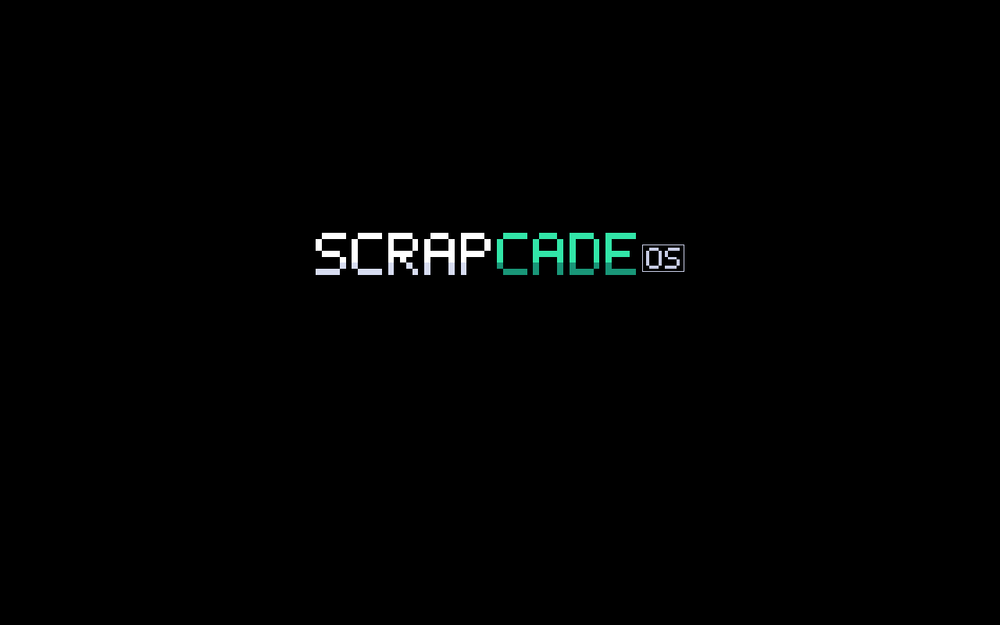
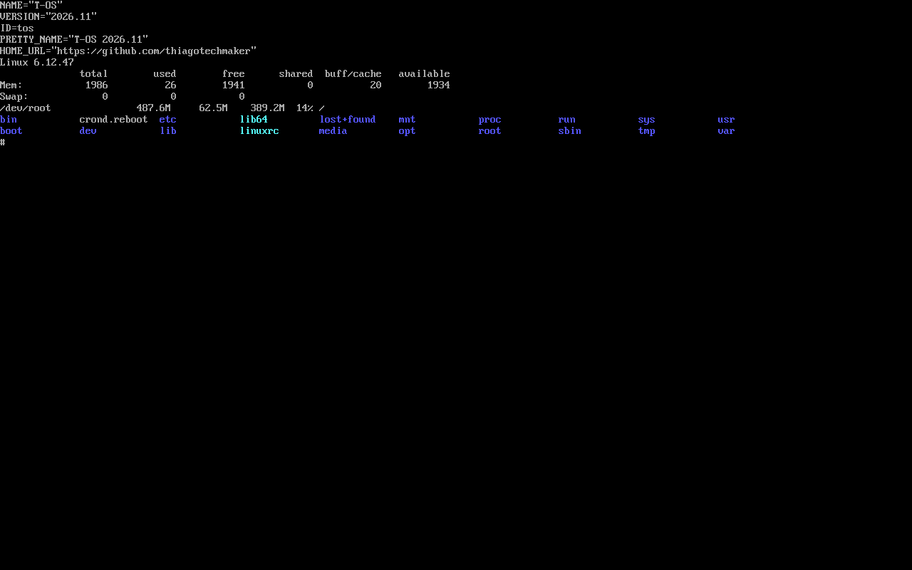

# T-OS

Sistema operacional próprio, baseado em Linux, voltado para **emulação de jogos** e para dar uma **segunda vida a computadores e aparelhos que iriam para o lixo**.

O T-OS é montado com o [Buildroot](https://buildroot.org), a mesma ferramenta usada pelo Batocera. Ele não é uma distribuição pronta: o Buildroot compila do código-fonte só o que o sistema precisa, e gera uma imagem pronta para gravar.

> **Estado atual (2026.11): base mínima.** O sistema liga no PC com UEFI e chega ao login. Ainda não tem menu de jogos nem emuladores. Eles vêm nas próximas etapas.

## Capturas

**1. GRUB iniciando o T-OS** (espera de 1 segundo):


**2. Boot do Linux** até a tela de login:



**3. Sistema ligado:** identificação, versão do kernel, memória e disco em uso:



Depois de ligar, o T-OS usa **26 MB de RAM** e **62 MB de disco**.

## O que cada parte faz

| Parte | O que faz |
|---|---|
| **GRUB 2 (UEFI)** | Primeiro programa que roda quando o PC liga. Encontra o kernel na partição de boot e o inicia. |
| **Kernel Linux 6.12.47 (LTS)** | Coração do sistema: conversa com o processador, a memória, os discos, a placa de rede e o vídeo. A versão LTS recebe correções por anos. |
| **Compilador Bootlin (glibc)** | Conjunto de compiladores pronto, usado para compilar o sistema todo. Economiza cerca de 30 minutos por compilação. |
| **BusyBox** | Reúne em um só programa pequeno o `init` (primeiro processo, que inicia os outros), o terminal e os comandos básicos (`ls`, `cp`, `mount`...). |
| **eudev** | Detecta o hardware ligado (pen drive, controle, placa de rede) e cria os arquivos de dispositivo em `/dev`. |
| **D-Bus** | Canal de comunicação entre os serviços do sistema. |
| **ConnMan** | Gerencia a rede: cabo e Wi-Fi. |
| **linux-firmware** | Firmwares das placas de Wi-Fi e rede (Intel, Realtek, Atheros, Ralink). Sem eles, essas placas não funcionam. |
| **syslogd / klogd** | Guardam os registros do sistema e do kernel, para descobrir problemas. |
| **acpid** | Trata o botão de ligar e eventos de energia (desligar ao apertar o botão). |
| **crond** | Executa tarefas agendadas. |
| **Primeiro boot** | Script `S01primeiro-boot`: se o administrador ainda não tem senha, pede para criar uma antes do login. |
| **genimage** | Monta o `disk.img` final: tabela GPT, partição EFI (com o GRUB e o kernel) e partição do sistema (ext4, 512 MB). |

## Como foi feito

1. **Ambiente:** Ubuntu 24.04 no WSL2 (Windows), com as ferramentas que o Buildroot exige (`build-essential`, `git`, `rsync`, `bc`, `cpio`, `unzip`, `wget`, `file`, `python3`, `libncurses-dev`...).
2. **Buildroot 2026.02.3 (LTS)**, baixado do repositório oficial.
3. **Árvore externa própria** (`external/`): tudo que é do T-OS fica separado do Buildroot. Assim dá para atualizar o Buildroot sem perder as mudanças.
4. **Configuração `tos_x86_64_defconfig`**, partindo da configuração de PC com UEFI do Buildroot, com:
   - nome, versão e hostname do T-OS (`/etc/os-release`, `/etc/issue`);
   - compilador estável da Bootlin;
   - partição do sistema de 512 MB;
   - menu do GRUB com o nome T-OS e espera de 1 segundo;
   - boot silencioso (`quiet`), sem os textos do kernel na tela;
   - pedido de senha do administrador no primeiro boot.
5. **Compilação:** cerca de 27 minutos na primeira vez (Ryzen 7, 16 threads), poucos minutos nas seguintes.
6. **Teste:** máquina virtual QEMU com firmware UEFI (OVMF).

## Estrutura do repositório

```
external/
  external.desc              nome da árvore externa (TOS)
  Config.in, external.mk     pacotes próprios do T-OS (ScrapCade etc., futuramente)
  configs/
    tos_x86_64_defconfig     configuração da imagem para PC 64 bits
  board/
    x86_64/                  GRUB, kernel, scripts de imagem do PC (base do Buildroot)
    common/rootfs-overlay/   arquivos que entram em todas as imagens (identidade do T-OS)
build-x86_64.sh              compila a imagem x64
docs/capturas/               prints do sistema
```

## Como compilar

No Ubuntu (ou WSL2 com Ubuntu):

```bash
sudo apt install -y build-essential git rsync bc cpio unzip wget file python3 libncurses-dev perl patch gzip bzip2 tar
git clone https://github.com/thiagotechmaker/t-os.git ~/t-os
git clone --depth 1 --branch 2026.02.3 https://gitlab.com/buildroot.org/buildroot.git ~/t-os/buildroot
bash ~/t-os/build-x86_64.sh
```

A imagem fica em `~/t-os/output/x86_64/images/disk.img`.

## Como testar sem gravar pen drive

```bash
sudo apt install -y qemu-system-x86 ovmf
qemu-system-x86_64 -m 2048 -bios /usr/share/ovmf/OVMF.fd \
  -drive file=$HOME/t-os/output/x86_64/images/disk.img,format=raw,if=virtio -snapshot
```

**Primeiro boot:** o T-OS pede para criar a senha do administrador (`root`) antes de liberar o login. A imagem não traz senha fixa, porque uma senha publicada seria a mesma em todo aparelho.


## Próximos passos

1. RetroArch e os primeiros núcleos (8/16 bits, PS1, N64).
2. ScrapCade em C/C++ com SDL2: menu de jogos com carrossel de capas.
3. Logo de boot do T-OS e início direto no menu.
4. Transferência de jogos (página web, pasta na rede, pen drive) e menu Select + Start.
5. Imagens x86 32 bits, Raspberry Pi e TV boxes.

As definições completas do sistema estão em [docs/DEFINICOES.md](docs/DEFINICOES.md).

## Licença

Código do T-OS: **GPLv3** (ver [LICENSE](LICENSE)). Os arquivos em `external/board/x86_64/` vêm da configuração de PC do Buildroot (GPL-2.0 ou posterior). Os programas incluídos na imagem mantêm as licenças dos seus autores.
