# ScrapCade OS

<p align="center">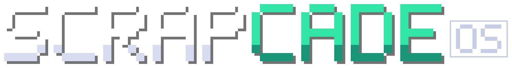</p>

<p align="center">
  
  
  
  
</p>

**Computador velho vira videogame.** O ScrapCade OS é um Linux próprio que liga direto num menu de jogos. Roda em PCs de 64 bits e em PCs antigos de 32 bits, por BIOS antigo ou UEFI, do pen drive ou instalado no HD.

<p align="center"><a href="https://github.com/thiagotechmaker/scrapcade.os/releases/latest"><b>Baixar a versão mais nova</b></a> · <a href="https://thiagotechmaker.github.io/scrapcade/">Site</a> · <a href="https://github.com/thiagotechmaker/scrapcade.os/discussions">Conversas</a></p>

## Sobre e capturas

1. Baixe o `.iso` (`pc-64bits` ou `pc-32bits`) nas [Releases](https://github.com/thiagotechmaker/scrapcade.os/releases/latest).
2. Grave num pen drive de 4 GB ou mais com o [Rufus](https://rufus.ie) ou o [balenaEtcher](https://etcher.balena.io).
3. Ligue o PC pelo pen drive. No primeiro boot ele se arruma sozinho e cria o seu perfil; para ficar no HD (sozinho ou ao lado do Windows), *Sistema > Instalar*.

Jogos, BIOS e ROMs não acompanham o sistema: mande os seus pelo navegador do celular, pela rede do Windows ou por um pen drive.

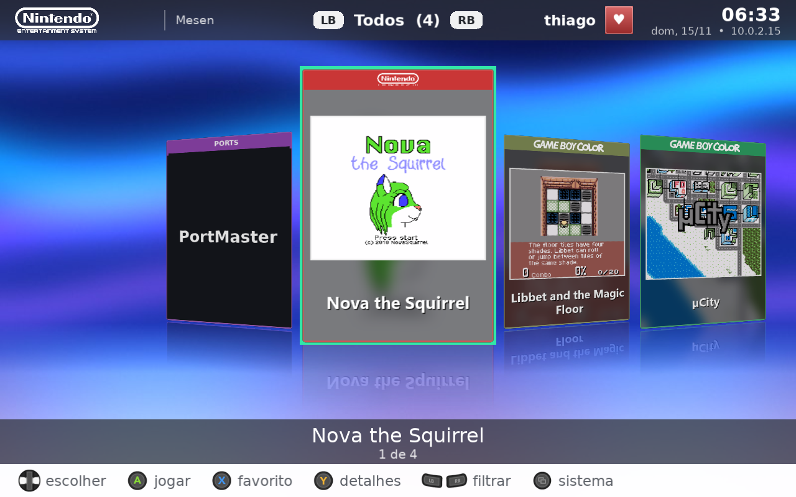

<details><summary>Ver mais capturas</summary>

<p align="center">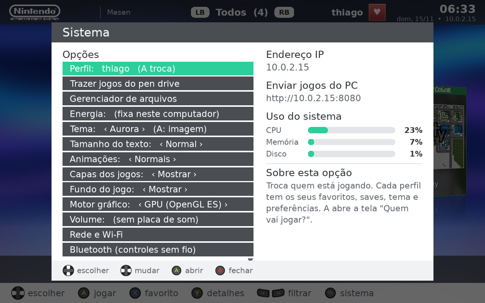 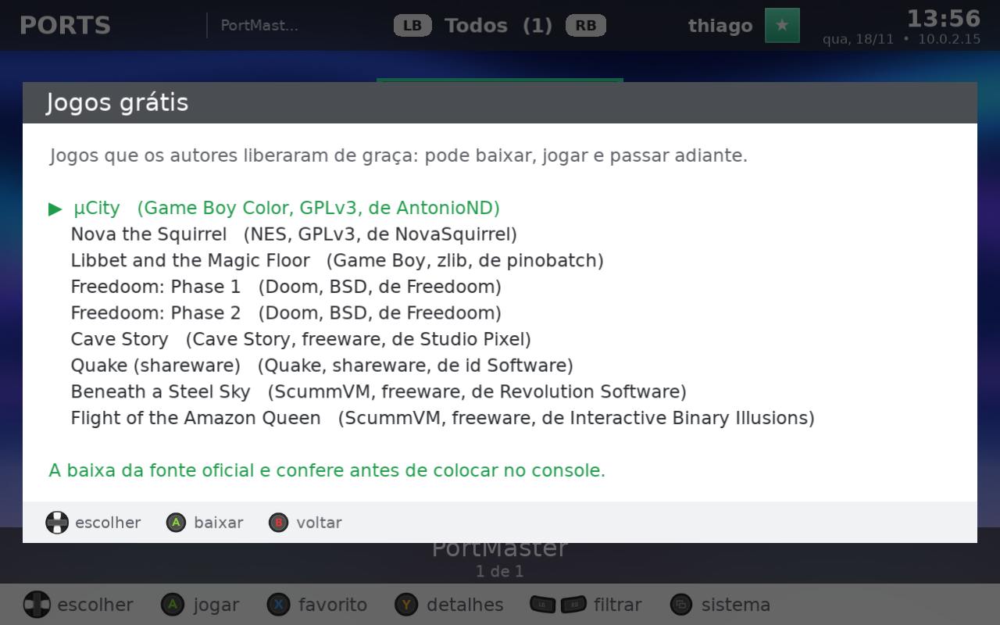</p>
<p align="center">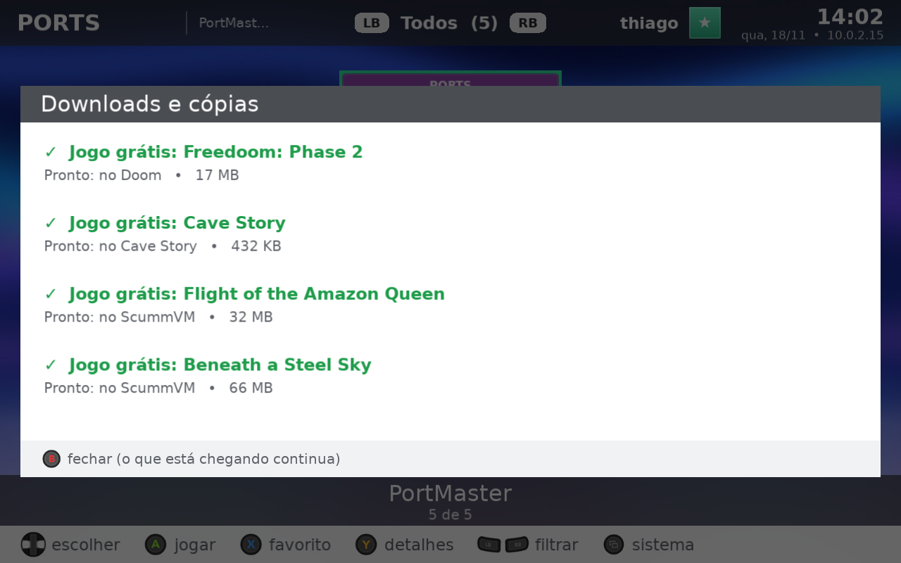 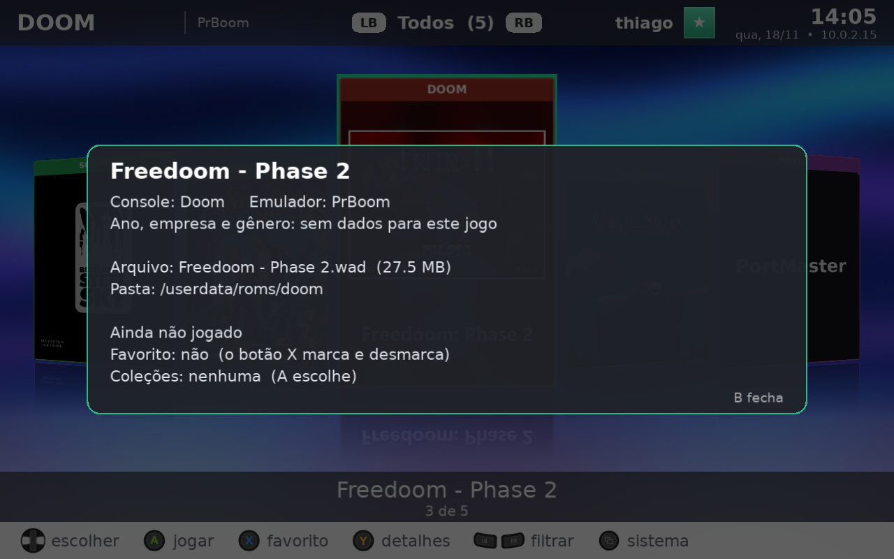</p>
<p align="center">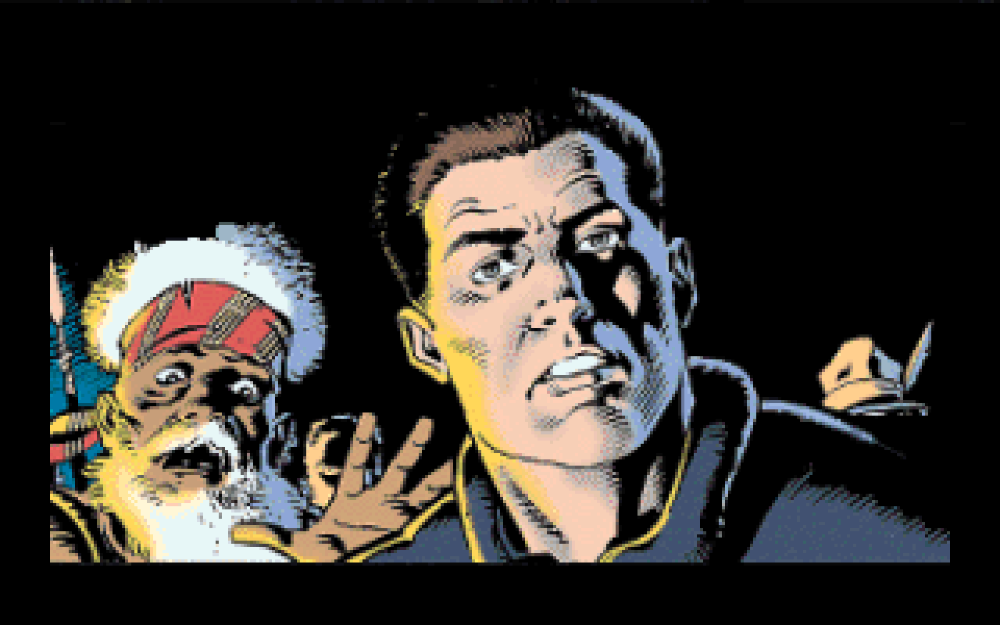 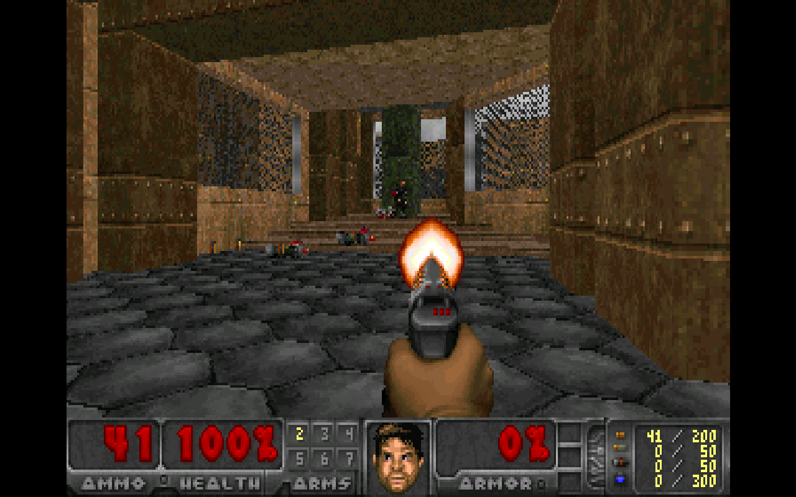</p>
<p align="center">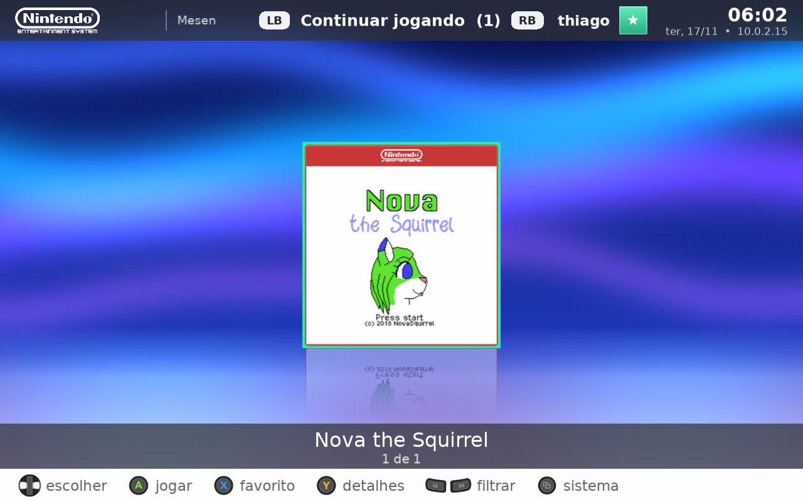 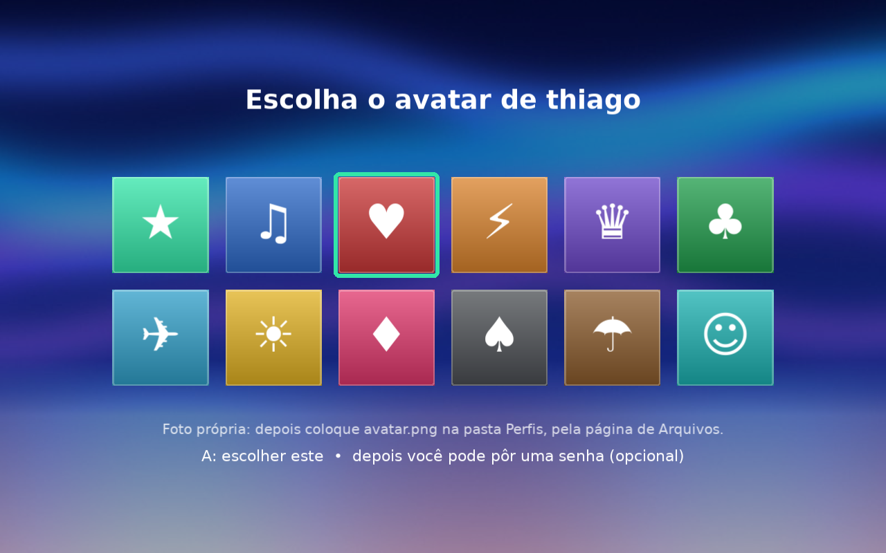</p>
<p align="center"> 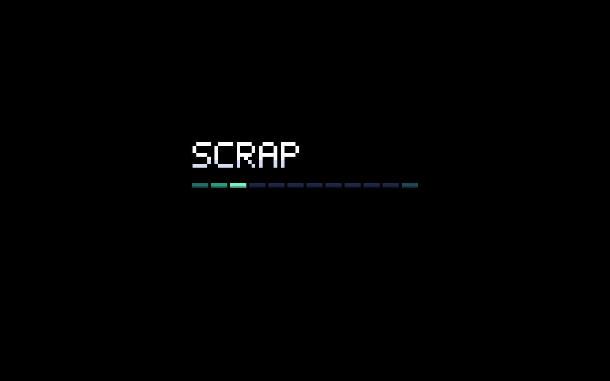</p>

Os jogos das capturas foram liberados de graça pelos autores: de fãs, com licença livre ([µCity](https://github.com/AntonioND/ucity), [Nova the Squirrel](https://github.com/NovaSquirrel/NovaTheSquirrel), [Libbet](https://github.com/pinobatch/libbet), [Freedoom](https://freedoom.github.io)), e freeware ([Cave Story](https://studiopixel.jp), [Beneath a Steel Sky e Flight of the Amazon Queen](https://www.scummvm.org/games/)). O sistema baixa todos em *Sistema > Jogos grátis*.

</details>

<details><summary>Ver tudo o que o sistema faz</summary>

- **Consoles:** NES, Super Nintendo, Nintendo 64, Game Boy (Color, Advance), Nintendo DS, Virtual Boy; SG-1000, Mega Drive, Master System, Game Gear, Sega CD, 32X, Saturn, Dreamcast; PlayStation, PSP; PC Engine (e CD); Atari 2600, 5200, 7800, Lynx e Jaguar; ColecoVision, Intellivision, Odyssey², Vectrex, 3DO; Neo Geo, Neo Geo CD, Neo Geo Pocket, WonderSwan; fliperama (FBNeo e MAME 2003-Plus).
- **Computadores e jogos de PC:** MSX, Commodore 64, Amiga, Atari ST, PC antigo (DOS), Doom, Quake, Cave Story, Half-Life (com a sua cópia da Steam), aventuras do ScummVM, jogos do RPG Maker (EasyRPG) e os ports do PortMaster.
- **Só na versão de 64 bits:** Dreamcast, Saturn, PSP, Nintendo DS, PlayStation 2, PlayStation 3, Xbox, GameCube, Wii e 3DS.
- **Menu:** carrossel de capas com filtros, "Continuar jogando" com a foto de onde parou, favoritos, coleções, perfis com avatar, 8 temas ou uma imagem sua, sons, proteção de tela com as cenas dos jogos, em português ou inglês.
- **Jogando:** voltar de onde parou, pacote completo de filtros (um por console), molduras, proporção, run-ahead, FPS na tela, emulador de cada console, jogar online, conquistas (RetroAchievements). Select + Start sai; Select + X abre o menu do emulador; Select + Y tira print.
- **Jogos:** jogos grátis que os autores liberaram, trazer do pen drive (o pen drive arrumado por console vai direto para a pasta certa), central de downloads com o progresso de cada um, gerenciador de arquivos, BIOS dos consoles, cópia dos saves.
- **Sistema:** Wi-Fi, Bluetooth, pasta na rede do Windows, SSH, saves sincronizados (Syncthing), botão de energia com menu, fuso horário, desempenho ajustado ao PC, atualização A/B (se a nova não ligar, volta para a anterior), instalar no HD ou ao lado do Windows, página do celular em português ou inglês.
- **Modo desktop:** navegador, gerenciador de arquivos, editor de texto, planilha (Gnumeric), leitor de PDF e imagens, player de vídeo e música.

</details>

O mesmo menu roda num analisador de laboratório reaproveitado: [ScrapCade no iChroma](https://github.com/thiagotechmaker/scrapcade-fliperama).

## Hardware suportado

Para ligar: PC de 64 bits com 2 GB de memória, ou PC de 32 bits (Pentium 4, Pentium M, Atom) com 1 GB. O que cada console pede está na [tabela do site](https://thiagotechmaker.github.io/scrapcade/#consoles).

| Máquina | Boot | Vídeo | Som | Rede | Situação |
|---|---|---|---|---|---|
| QEMU x86_64 (UEFI e BIOS) | ✅ | ✅ | ✅ | ✅ | testado a cada versão (`tests/testar.sh`) |
| QEMU i386 (Atom N270, BIOS) | ✅ | ✅ | — | ✅ | testado a cada versão (`tests/testar-32.sh`) |

<details><summary>Ver os drivers incluídos</summary>

- **Vídeo:** Intel (i915, crocus, iris), AMD (amdgpu, radeon, radeonsi, r300, r600), NVIDIA (nouveau), Vulkan (ANV, lavapipe) e desenho pela CPU (llvmpipe).
- **Som:** Intel HDA e placas USB, com PipeWire.
- **Rede com cabo:** Intel, Realtek, Atheros, Broadcom, Marvell, nForce, VIA e adaptadores USB.
- **Wi-Fi:** Intel, Atheros, Ralink/MediaTek e Realtek, com os firmwares redistribuíveis.
- **Controles:** Xbox, PlayStation 3/4/5, Switch, Steam e genéricos (banco do SDL2), Bluetooth e assistente para controle desconhecido.

</details>

<details><summary>Ver o teste de cada console (v0.22.2)</summary>

Um jogo de cada console aberto pelo menu, como uma pessoa faria: pen drive arrumado por console (`roms/<console>`, `bios`) ligado com o menu aberto, cópia pela central de downloads, jogo aberto, jogando e de volta ao menu. Feito no QEMU, sem placa de vídeo (o desenho é pela CPU), então os consoles pesados aparecem bem mais lentos que num PC de verdade.

| Resultado | Consoles |
|---|---|
| ✅ abre e volta ao menu | NES, Super Nintendo, Nintendo 64, Game Boy, Game Boy Color, Game Boy Advance, Nintendo DS, Mega Drive, SG-1000, Game Gear, Sega CD (`.chd`), 32X, Saturn, Dreamcast, 3DO (`.chd`), PlayStation, PlayStation 2, PSP, GameCube, Xbox, fliperama (FBNeo), Neo Geo, Doom, Quake, Cave Story, ScummVM |
| 🟡 sem conclusão na máquina virtual | Wii (fica carregando) e 3DS (tela preta depois de formatar os dados): pedem placa de vídeo de verdade |
| — sem jogo no teste | Master System, PC Engine (e CD), Atari 2600, 5200, 7800, Lynx e Jaguar, ColecoVision, Intellivision, Odyssey², Vectrex, Neo Geo CD, Neo Geo Pocket, WonderSwan, Virtual Boy, MSX, Commodore 64, Amiga, Atari ST, DOS, RPG Maker, PS3, Half-Life, ports do PortMaster |

A cada versão, `tests/conferir-bibliotecas.py` confere que todo console tem emulador instalado e que todo emulador abre (bibliotecas, símbolos e pilha).

</details>

**Limitações:** Dreamcast, Saturn, PSP, Nintendo DS, PS2, PS3, Xbox, GameCube, Wii e 3DS só na versão de 64 bits; os seis últimos pedem um PC forte (o PS3 pede processador com SSE4.1 e de preferência 4 núcleos); Xbox 360 ainda não (o emulador não roda jogos no Linux); poucos ports do PortMaster rodam em PC; sem Secure Boot.

## Estrutura de pastas

```
.
├── build-x86_64.sh, build-i686.sh   compilam as imagens de 64 e de 32 bits (output/)
├── external/                        árvore externa do Buildroot (BR2_EXTERNAL)
│   ├── configs/                     tos_x86_64_defconfig, tos_i686_defconfig
│   ├── board/x86_64/                boot (GRUB, syslinux, initramfs), kernel, scripts de imagem e .iso
│   ├── board/common/                rootfs-overlay: comandos tos-*, serviços, configuração do RetroArch
│   └── package/                     scrapcade (o menu, C++/SDL2), retroarch, núcleos libretro, xash3d-fwgs,
│                                    xemu e RPCS3 (AppImages oficiais) e os programas do modo desktop
├── tests/                           testes automáticos no QEMU e telas de referência
├── scripts/                         publicar-versao.ps1
├── docs/                            detalhes técnicos, composição, roteiro e capturas
└── VERSION                          número da versão (SemVer)
```

## Como compilar

Ubuntu 24.04 (ou WSL2), uns 70 GB livres para uma versão (130 GB para a de 64 e a de 32 bits):

```bash
sudo apt install build-essential gcc-multilib git wget unzip rsync bc cpio file libncurses-dev python3 \
                 qemu-system-x86 ovmf mtools dosfstools python3-pil
git clone https://github.com/thiagotechmaker/scrapcade.os.git ~/scrapcade.os
git clone --depth 1 --branch 2026.02.3 https://gitlab.com/buildroot.org/buildroot.git ~/scrapcade.os/buildroot
bash ~/scrapcade.os/build-x86_64.sh      # 32 bits: build-i686.sh
bash ~/scrapcade.os/tests/testar.sh      # 32 bits: tests/testar-32.sh
```

A primeira compilação leva algumas horas; as seguintes, minutos. Mais em [docs/DETALHES.md](docs/DETALHES.md) e no [CHANGELOG](CHANGELOG.md).

## Licença

**GPLv3** (ver [LICENSE](LICENSE)). O kernel e cada programa incluído mantêm a licença dos seus autores ([docs/COMPOSICAO.md](docs/COMPOSICAO.md)); o hlsdk-portable segue a licença do Half-Life 1 SDK (distribuição só gratuita), e os dados do jogo não acompanham o sistema. Logotipos de consoles são dos seus donos e aparecem só para identificação.
